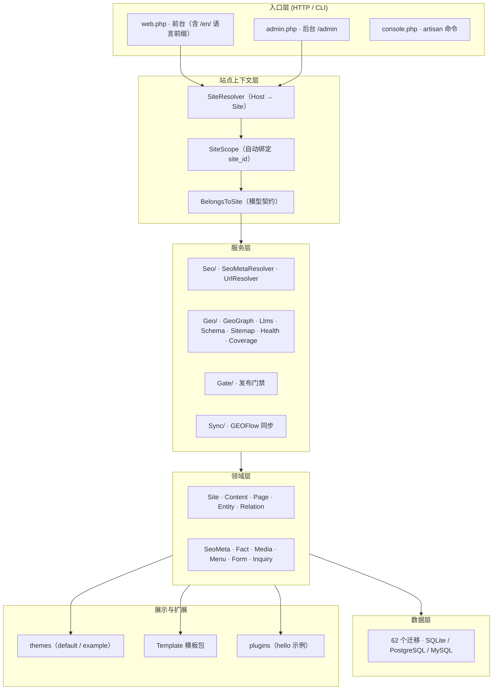

<div align="center">

<a href="https://github.com/jackyduhai/geo-website-os">
  
</a>

# GEO Website OS

**多站点 · 多语言 · GEO/SEO 优先的企业内容与实体操作系统（基于 Laravel 12）**

一套代码，运行多个相互隔离的网站；每个站点拥有自己的内容、实体、知识图谱与机器可读的 GEO/SEO 输出——面向**人类访客**与**生成式搜索 / 大模型（AI）**两类消费者。

[**中文**](README.md) · [**English**](README_EN.md)


[](https://github.com/jackyduhai/geo-website-os/releases)

</div>

---

## 这是什么？

**GEO Website OS（GEO 网站操作系统）**是一个多站点、多语言、GEO/SEO 优先的企业内容与实体操作系统。

它解决一个传统建站系统解决不了的问题：**让企业事实被 AI 正确读到、引用、信任**。

- 传统建站系统解决「把页面做出来」；
- GEO Website OS 解决「让 AI 搜索引擎读到的是高质量、可信任、跨出口一致的企业事实」。

它面向生成式搜索时代：在传统 SEO（canonical、Open Graph、sitemap、RSS、hreflang）之外，
每个站点还输出 AI 可读的结构化产物——`schema.org` JSON-LD、`geo.json`、`llms.txt`，
并且这些产物与页面内容**来自同一个事实权威源（facts 表）**，由契约测试强制跨出口一致。

> 一句话：**它是 AI 时代的企业官网 / 企业公开知识入口，不是又一个 CMS。**
> 详见 [项目概述](docs/overview.md)。

## 为什么需要它，而不是传统 CMS 或 SEO 插件？

| 维度 | 传统 CMS / SEO 插件 | GEO Website OS |
| --- | --- | --- |
| 多站点 | 多套安装或插件拼凑 | **原生**：Host 解析 + 数据库/查询双层隔离 + 站点感知缓存，查询参数也无法绕过 |
| 多语言 | 插件级翻译 | **行级翻译模型**（`locale` + `translation_group`），同一 slug 跨语言共存，数据库级约束 |
| AI 可发现性 | 通常只有 sitemap / robots | **6 类机器可读出口**：sitemap.xml / llms.txt / feed.xml / geo.json / robots.txt / 页面 JSON-LD |
| 事实一致性 | 无约束，页面与结构化数据可互相矛盾 | **AI 事实契约**：facts 表唯一权威源，跨出口 / 跨语言 / 跨站一致由测试强制 |
| 实体与知识图谱 | 通常没有 | 8 类通用实体 + 类型化关系（EntityRelation） |
| 扩展 | 主题/插件各异 | 主题（Theme）+ 声明式模板包（Template）+ 插件（Plugin），运行时可启用/停用 |

## 核心能力

- **多站点（Multi-site）**：`Host` 头解析站点、`SiteScope` 自动隔离、站点感知缓存；CLI 与队列任务显式携带站点上下文；跨站访问是显式的管理员授权能力。
- **多语言（Multi-language）**：`zh-CN`（默认）+ `en`，建站时按站启用；未启用语言返回 404 而非静默回落。
- **实体与知识图谱（Entity & Knowledge Graph）**：8 类实体（organization / person / product / service / location / topic / case_study / download_asset）+ 五型关系（produces / offers / uses / located_in / related_to），数据库级唯一约束与外键。
- **统一 SEO + GEO 层**：`SeoMetaResolver` 继承链、`UrlResolverInterface`（canonical）、JSON-LD / geo.json / llms.txt / sitemap / feed / robots 构建器，内容与实体为平行资源。
- **AI 事实契约（AI Fact Contract）**：facts 表是业务事实唯一权威源，`geo.json` 与 `llms.txt` 必须经 `Fact::publicRows($locale)` 取得；新增事实须同时登记 Seeder 与标签，否则契约测试失败。
- **CMS**：内容（文章/页面）、实体、关系、媒体、导航、分类、分组、表单、询盘、治理、回收站、修订。
- **主题 / 模板 / 插件**：Theme 视图覆盖、声明式 Template 包（激活/停用/迁移/校验 + 实时预览）、Plugin 插件（示例 `plugins/hello`）。
- **生命周期**：`php artisan geo:install` 一键安装；`geo:upgrade` 有序幂等迁移（62 个，up/down 均受测）；备份 / 恢复 / 回滚脚本化并有演练。
- **性能**：整页静态化缓存（PageCache），匿名外壳 + 按会话回填 CSRF，后台变更自动失效。
- **搜索**：`/search`（SQLite FTS5；PostgreSQL / MySQL 走普通索引）。
- **GEOFlow 上游内容同步 API**：上游系统（ERP、爬虫、AI 内容流水线、另一个 CMS）通过 REST API 把文章、页面、产品内容直接推进系统，自动完成创建、更新、下架——不用人工复制粘贴。推送是**幂等的**（重复推同一篇不会产生重复内容），人工锁定的内容不会被上游覆盖，所有推送都走和后台相同的发布门禁，每次写入都有日志可审计。默认关闭（`GEOFLOW_SYNC_ENABLED=false`），配置 Bearer Token 后开启即可。

### GEOFlow：让内容自动流进来，而不是手工搬

大多数建站系统的内容是「人在后台一篇篇敲」。GEO Website OS 多了一条通道：**上游系统可以通过 API 直接把内容推进来**。

**典型场景：**
- 你的 ERP / 商品库上新了一款产品，自动在官网生成产品页；
- 爬虫或 AI 流水线抓到了行业资讯，自动写成文章草稿；
- 另一个 CMS 更新了内容，自动同步过来保持一致；
- 不用开后台、不用复制粘贴、不用担心漏发。

**推进来之后会发生什么：**
1. 系统按字段契约校验内容（标题、正文、日期、分类等字段格式不对直接拒收，不会写脏数据）；
2. 走和后台手工发布完全相同的**发布门禁**（ContentGate），不满足条件不会直接上线；
3. 幂等处理：同一篇内容重复推 100 次，数据库里只有一条记录；
4. 人工锁定的内容（你在后台标了「锁定」）不会被上游覆盖，冲突只记录、等人处理；
5. 每次推送都写同步日志（sync_logs），谁推了什么、结果如何，随时可查可审计。

**支持的操作：** 创建（create）、更新（update）、跳过（skip，内容没变就不重复写）、下架（unpublish）。
**支持的内容类型：** 文章（article）、页面（page）、产品（product）。
**安全：** Bearer Token 鉴权，总开关关闭时所有写入口直接拒绝（不只是 upsert）。

> 当前版本这个 API 已经建好并通过 **108 项测试**，默认关闭是因为还没有上游系统接入——配好 Token、打开开关就能用。

## GEO、SEO、CMS 之间的关系

```text
CMS（内容与实体管理：内容 / 实体 / 事实 / 分类 / 媒体 / 表单 / 询盘 / 治理）
   │
   ▼
SEO（面向传统爬虫）                 GEO（面向生成式引擎 / 大模型）
   ├─ canonical / hreflang / OG       ├─ geo.json（实体 / 知识图谱）
   ├─ sitemap.xml / robots.txt        ├─ llms.txt（站点摘要与引用）
   ├─ feed.xml                        └─ AI 爬虫白名单（robots.txt）
   └─ 页面 JSON-LD（schema.org）
   └────────── 同一事实源（facts 表）──────────┘
```

三者不是三个独立模块，而是**一套数据模型的三类出口**：CMS 生产与维护事实，SEO 与 GEO 从同一事实源派生，AI 事实契约保证两类出口不互相矛盾。

## 系统架构



> 分层与 `app/`、`routes/`、`database/` 目录一一对应；完整机制（多站点、多语言、GEO 实现、缓存）见 [系统架构](docs/architecture.md)。

## 技术栈与兼容性

| 项 | 值 |
| --- | --- |
| 语言 / 框架 | PHP **8.4+** · Laravel **^12.0** |
| 依赖管理 | Composer 2.x |
| 数据库 | SQLite（默认，零配置）· PostgreSQL 16（正式支持，CI 门禁）· MySQL 8.0+（**候选支持**，实测无 CI 门禁） |
| Node.js | 20+（**可选**，仅自行构建前端资产时需要；运行与发布制品不依赖） |
| 迁移 | 62 个（v1.0.0=56 → v1.4.0=62），三库同集 |

## 快速开始（本地，约 5 分钟）

```bash
composer install
cp .env.example .env
php artisan key:generate
touch database/database.sqlite

# 一键安装：迁移 → 默认站点 → 出厂结构 → 系统页 → 栏目骨架 → 搜索索引 → 管理员
# （未指定 --admin-password 时随机生成并打印一次）
php artisan geo:install --site-name="我的站点" --site-domain="example.com" --admin-email="admin@example.com"

php artisan serve
```

安装完成后即可访问：

| 入口 | 地址 |
| --- | --- |
| 前台首页 | `http://127.0.0.1:8000/` |
| 后台登录 | `http://127.0.0.1:8000/admin` |
| GEO / SEO 出口 | `/geo.json` · `/llms.txt` · `/sitemap.xml` · `/feed.xml` · `/robots.txt` |

需要通用 Example 演示数据（开发/演示环境）：

```bash
php artisan db:seed
```

> 生产部署（Nginx + PHP-FPM + 宝塔 / 云端）：见 [DEPLOY.md](DEPLOY.md) 与
> [安装与部署教程](docs/installation.md)。数据库升级 / 备份 / 恢复逐条命令见
> [数据库支持矩阵](docs/operations/database-support-and-recovery.md)。

## 配置要点（.env）

| 变量 | 默认值 | 说明 |
| --- | --- | --- |
| `APP_ENV` / `APP_DEBUG` | `local` / `false` | 生产用 `production` / `false` |
| `SITE_DEFAULT_FALLBACK` | `true` | 单站/开发回落默认站；**多站生产设 `false`**（未知 Host 返回「站点不存在」） |
| `APP_LOCALE` | `zh-CN` | 默认语言 |
| `DB_CONNECTION` | `sqlite` | `sqlite` / `pgsql` / `mysql` |
| `GEOFLOW_SYNC_ENABLED` | `false` | GEOFlow 上游内容同步 API 开关，配置 Bearer Token 后设为 `true` 开启 |

完整配置说明见 [安装与部署教程](docs/installation.md) 第 3 节。

## 核心使用流程

1. 建站（后台「站点」或 `geo:install`）→ 自动完成初始化结构（栏目、导航、默认设置、系统页、双语开关）；
2. 建内容 / 实体 / 事实（facts 是 AI 出口的**唯一事实源**）；
3. 配置 SEO 元数据（Site / Content / Entity / Page 范围绑定）；
4. 发布（受发布门禁校验）→ 前台立即可见，整页缓存自动失效；
5. 验证机器可读出口：`/geo.json`、`/llms.txt`、`/sitemap.xml`、`/feed.xml`、`/robots.txt`、页面 JSON-LD；
6. 通过「GEO 健康 / 覆盖度」观察语义健康与资产齐备度。

详细操作见 [使用手册](docs/usage.md)。

## 测试与质量验证

```bash
php vendor/bin/phpunit
```

- 全量基线（v1.4.0）：**1761 tests / 9470 assertions / 0 failures / 0 errors / 0 skipped**（SQLite）。
- CI（`.github/workflows/ci.yml`）：`test (8.4)` 精确计数门禁 + `PostgreSQL 16` 零失败门禁（PgsqlCore，≥174 例）+ `release`（tag 触发，构建 zip + SHA-256 + manifest）。
- 跨库结构一致性由 `DatabaseStructureParityTest` 锁定；真实多进程并发、升级/回滚/备份恢复演练已实测。
- 覆盖多站点隔离、实体/关系约束、SEO 解析、GEO 输出、安装/升级/回滚、主题/插件、**反向业务污染断言**。
- 详细口径见 [开发与维护](docs/development.md) 与 [CI 门禁](docs/operations/ci-release-gates.md)。

## 当前版本、支持范围与已知限制

- **当前版本**：v1.4.0（2026-10-28 发布，[Release](https://github.com/jackyduhai/geo-website-os/releases) 含 zip / SHA-256 / manifest）。
- **已知限制（如实声明）**：
  - MySQL 为**候选支持**（8.4 实测通过，无 CI 门禁）；PostgreSQL / MySQL 全量回归不进 CI（CI 只跑 PgsqlCore 子集）。
  - 9 个测试用例仅 SQLite 验证（站点创建生产等价 7 项 + 升级/回滚 E2E 2 项），PG/MySQL 上零证据。
  - `php artisan geo:version` 输出 `app.version=1.0.0`（config/geo.php 默认值），与发布标签 v1.4.0 不一致，属已知版本口径待办。
  - Admin UI 仅中文；settings 同站跨语言共用 4 键；分类/分组为字段级 `name_en` 翻译。
  - 路线图能力（定时发布、内容引擎、分析面板等）**均未实现**，见 [路线图](docs/roadmap.md)。

## 文档导航

- [文档总导航](docs/README.md)
- [项目概述](docs/overview.md) · [系统架构](docs/architecture.md)
- [安装与部署教程](docs/installation.md) · [DEPLOY.md（生产部署）](DEPLOY.md)
- [使用手册](docs/usage.md) · [FAQ 与故障排查](docs/faq.md)
- [开发与维护](docs/development.md) · [路线图与当前边界](docs/roadmap.md)
- [数据库支持矩阵](docs/operations/database-support-and-recovery.md) · [CI 与发布门禁](docs/operations/ci-release-gates.md)
- 代码规范：[code-standard](docs/code-standard.md) · [design-system](docs/design-system.md) · [html-standard](docs/html-standard.md) · [css-standard](docs/css-standard.md)

## 贡献方式

- 贡献指南：[CONTRIBUTING.md](CONTRIBUTING.md)
- 安全漏洞：**不要开公开 issue**，请按 [SECURITY.md](SECURITY.md) 私密报告。
- 核心纪律：保持核心通用——运行时代码、默认数据与发布的主题中**不得包含**客户名、品牌、联系方式或行业专属数据；反向污染断言在 CI 中执行。
- 行为准则：[CODE_OF_CONDUCT.md](CODE_OF_CONDUCT.md)

## 许可证

GEO Website OS 采用 [MIT 许可证](LICENSE) 开源。

---

## English Overview

**GEO Website OS** is a multi-site, multilingual, GEO/SEO-first content and entity operating system built on Laravel 12 / PHP 8.4+. One codebase runs multiple isolated websites, each with its own content, entities, knowledge graph, and machine-readable GEO/SEO outputs — serving both human visitors and generative search engines / LLMs.

**Why not a traditional CMS?** Traditional CMSs solve "how to render pages". This project solves "how to make business facts correctly read, cited and trusted by AI" — every AI-readable artifact (`schema.org` JSON-LD, `geo.json`, `llms.txt`, sitemap, feed, robots) is derived from one source of truth (`facts` table) with contract tests enforcing cross-output consistency.

**Key facts (v1.4.0, released 2026-10-28):**

- Multi-site by default: host resolution, DB + query-layer isolation, site-aware caching; query parameters cannot cross sites.
- Multi-language: `zh-CN` (default) + `en`, row-level translation model (`locale` + `translation_group`), `UNIQUE(site_id, slug, locale)`, locale-gated routes (404 instead of silent fallback).
- Entity & knowledge graph: 8 generic entity types + 5 typed relations.
- Unified SEO + GEO layer with `SeoMetaResolver` inheritance chains and builders for JSON-LD / geo.json / llms.txt / sitemap / feed / robots.
- Installer / upgrade / rollback: `php artisan geo:install`; 62 idempotent migrations; backup/restore scripted and drilled.
- Database support: SQLite (default) and PostgreSQL 16 are **supported** (CI-gated); MySQL 8.4 is **candidate** (validated, no CI gate yet).
- Quality: 1761 tests / 9470 assertions, 0 failures (SQLite); PostgreSQL zero-failure CI gate; cross-database structure parity enforced by tests.
- Known limitations: Admin UI is Chinese-only; `geo:version` still prints `app.version=1.0.0` (config default, pending alignment); roadmap items (scheduled publishing, content engine, analytics) are **not** implemented yet.

**Quick start:**

```bash
composer install && cp .env.example .env && php artisan key:generate
touch database/database.sqlite
php artisan geo:install --site-name="My Site" --admin-email="admin@example.com"
php artisan serve
```

Full English documentation: **[README_EN.md](README_EN.md)**.
