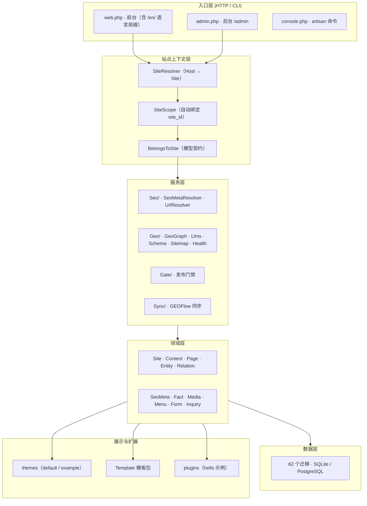

<div align="center">


# GEO Website OS

**GEO 时代的开源企业官网系统**

*The Open-Source Website OS for the GEO Era*

让企业官网不只是展示信息，更能被搜索引擎发现、被 AI 理解，并持续高效运营。

[English](./README_EN.md) · [文档](./docs/) · [快速开始](#快速开始)

</div>

---

## 项目介绍

GEO Website OS 是一套面向 **GEO（Generative Engine Optimization，生成式引擎优化）** 时代打造的开源企业官网系统。它以企业官网为核心，将内容管理、GEO 友好架构、多语言网站、模板化建站、结构化数据和 GEOFlow 内容协同整合在一起，帮助企业构建更容易被搜索引擎和 AI 系统理解、更容易维护和持续更新的官方网站。

> **不只是建一个官网，而是构建企业面向搜索与 AI 时代的数字内容基础设施。**

---

## 它解决什么问题？

传统企业官网往往面临几个共性问题：

- **难维护**：页面、栏目和内容管理分散，日常更新依赖技术人员。
- **不够 GEO 友好**：网站内容缺少清晰的语义结构和机器可理解的信息组织。
- **多语言维护成本高**：不同语言版本难以统一管理和持续更新。
- **内容生产效率低**：官网内容更新依赖人工编辑，难以形成持续运营机制。
- **网站难以规模化**：每个新网站都需要重复设计、开发和配置。

GEO Website OS 通过统一的内容管理与网站架构解决这些问题，让企业官网从一次性交付的展示页面，转变为**可持续维护、可扩展、可运营的内容平台**。

---

## 核心优势与功能

### 1. GEO 友好：让 AI 更容易理解企业网站

围绕生成式搜索与 AI 信息检索场景设计网站内容和技术架构。

- 面向 GEO 场景的内容组织与页面结构
- SEO 基础能力与搜索引擎友好的页面输出
- 结构化数据（Schema.org）支持
- 面向机器理解的网站内容表达
- `llms.txt` 等 AI 可读信息入口支持
- 多语言内容与页面语义组织

目标是让企业网站不仅能展示给用户，也能更清晰地向搜索引擎和 AI 系统表达**企业是谁、提供什么产品与服务、具备哪些专业信息**。

### 2. GEOFlow 协同：让官网内容更新更高效

GEO Website OS 不只是一个独立的内容发布工具，也可以与上游内容生产流程协同。

- 已实现的上游内容同步 REST API（article / page / product）
- 支持将生产好的内容导入或填充到官网
- 幂等处理：重复推送不产生重复内容
- 人工锁定保护：重要内容不会被上游覆盖
- 统一发布门禁与审计日志

> 当前版本 API 已实现并通过 108 项测试，**默认关闭**，配置 Bearer Token 后即可开启。让官网从"人工维护内容"，逐步走向"内容工作流驱动的持续运营"。

### 3. 模板化建站：降低企业官网建设与维护成本

通过可复用的模板和页面结构，提升网站建设效率。

- 可复用的网站模板（默认主题 + 示例主题）
- 声明式 Template 包（激活 / 停用 / 迁移 / 校验 + 实时预览）
- 支持不同企业官网的个性化配置
- 减少重复开发和重复维护
- 为后续扩展更多行业模板提供基础

### 4. 多语言能力：面向全球市场建设企业官网

支持企业在统一系统中管理多语言网站内容。

- 多语言网站与内容管理（行级翻译模型）
- 多语言页面与栏目组织
- 支持不同语言版本的内容维护
- 便于企业拓展海外市场与国际化业务

### 5. 统一内容管理：让官网真正容易维护

以内容管理为中心，降低企业日常运营对开发人员的依赖。

- 网站页面与栏目管理
- 内容创建、编辑与发布
- 多站点管理能力（Host 头解析 + 站点隔离）
- 统一的后台管理体验
- 可扩展的网站内容与业务结构

### 6. 开源与可扩展：企业可以自主掌控

- 开源代码，可自行部署和二次开发
- 支持企业私有化部署
- 基于 Laravel 技术栈构建
- 支持 SQLite 与 PostgreSQL
- 模块化架构，便于持续扩展

---

## 与传统 CMS 有什么不同？

| 对比维度 | 传统 CMS | GEO Website OS |
| --- | --- | --- |
| 核心定位 | 网站内容管理 | GEO 时代的企业官网系统 |
| 内容管理 | 页面与文章发布 | 统一内容管理与持续运营 |
| GEO 能力 | 通常需要额外配置 | 将 GEO 友好能力纳入系统设计 |
| AI 可理解性 | 主要面向用户和搜索引擎 | 更关注内容的语义表达与机器理解 |
| 内容生产 | 以人工编辑为主 | 可与上游内容工作流协同（GEOFlow） |
| 建站方式 | 依赖主题或定制开发 | 模板化与可复用页面结构 |
| 多语言 | 依赖插件或额外开发 | 系统级多语言网站管理能力 |
| 扩展方式 | 插件或定制开发 | 开源、模块化、可扩展 |

---

## 适合谁使用？

- 希望建设 GEO 友好型企业官网的企业
- 希望提升官网内容维护效率的企业
- 需要多语言、多站点官网的企业
- 提供企业官网建设与数字化服务的服务商
- 希望将 AI 内容生产与官网运营打通的团队
- 希望自主部署、掌控网站数据与系统能力的组织

---

## 系统架构



> 分层与 `app/`、`routes/`、`database/` 目录一一对应；完整机制见 [系统架构](docs/architecture.md)。

### GEO、SEO、CMS 之间的关系

```text
CMS（内容与实体管理：内容 / 实体 / 事实 / 分类 / 媒体 / 表单 / 询盘 / 治理）
   │
   ▼
SEO（面向传统爬虫）                 GEO（面向生成式引擎 / 大模型）
   ├─ canonical / hreflang / OG       ├─ geo.json（实体 / 知识图谱）
   ├─ sitemap.xml / robots.txt        ├─ llms.txt（站点摘要与引用）
   ├─ feed.xml                        └─ AI 爬虫白名单（robots.txt）
   └─ 页面 JSON-LD（schema.org）
   └────────── 同一事实源（facts 表）──────────┘
```

三者不是三个独立模块，而是**一套数据模型的三类出口**：CMS 生产与维护事实，SEO 与 GEO 从同一事实源派生，AI 事实契约保证两类出口不互相矛盾。

---

## 技术栈与兼容性

| 项 | 值 |
| --- | --- |
| 语言 / 框架 | PHP **8.4+** · Laravel **^12.0** |
| 依赖管理 | Composer 2.x |
| 数据库 | SQLite（默认，零配置）· PostgreSQL 16（正式支持）· MySQL 8.0+（候选支持） |
| Node.js | 20+（**可选**，仅自行构建前端资产时需要） |
| 迁移 | 62 个，三库同集 |
| 许可证 | MIT |

---

## 快速开始

### 环境要求

- PHP 8.4+
- Composer 2.x
- SQLite（默认）或 PostgreSQL 16

### 安装

```bash
# 克隆仓库
git clone git@github.com:jackyduhai/geo-website-os.git
cd geo-website-os

# 安装依赖
composer install

# 复制环境配置
cp .env.example .env

# 生成应用密钥
php artisan key:generate

# 创建数据库文件（SQLite 默认）
touch database/database.sqlite

# 运行迁移
php artisan migrate --force

# 运行安装向导
php artisan geo:install --no-interaction
```

### 启动开发服务器

```bash
php artisan serve
```

访问 `http://localhost:8000` 即可看到前台网站，`/admin` 进入后台管理。

---

## 文档导航

| 文档 | 说明 |
| --- | --- |
| [项目概述](docs/overview.md) | 系统定位、核心能力与边界 |
| [系统架构](docs/architecture.md) | 分层、模块关系与核心机制 |
| [安装指南](docs/installation.md) | 环境要求、配置与部署 |
| [路线图](docs/roadmap.md) | 当前版本能力与未来规划 |
| [贡献指南](CONTRIBUTING.md) | 如何参与项目开发 |

---

## 项目愿景

我们认为，GEO 时代的企业官网不应该只是一个展示企业信息的网页集合。

它应该成为企业在互联网和 AI 世界中的**可信信息载体**：

- 用户能够访问和理解；
- 搜索引擎能够发现和索引；
- AI 系统能够识别和理解；
- 企业团队能够持续维护和更新；
- 内容生产流程能够与官网协同；
- 网站能够随着企业业务发展不断扩展。

> **GEO Website OS：为 GEO 时代构建更容易被 AI 理解、更容易被企业运营的官方网站。**

---

## 许可证

[MIT](./LICENSE)
