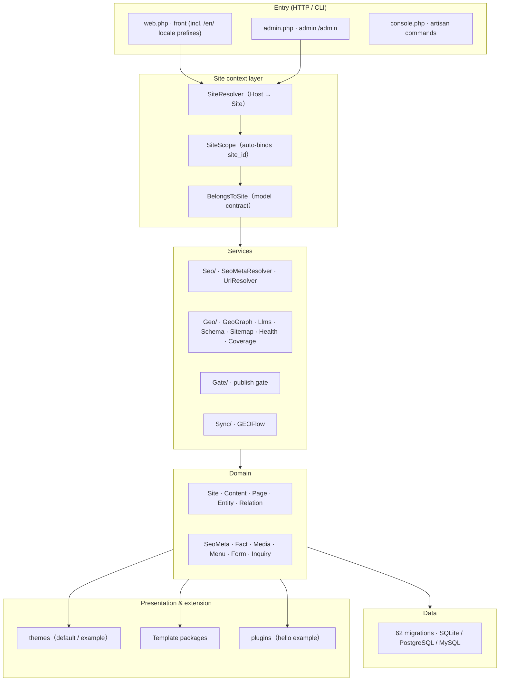

<div align="center">

<a href="https://github.com/jackyduhai/geo-website-os">
  
</a>

# GEO Website OS

**A multi-site, multilingual, GEO/SEO-first content and entity operating system built on Laravel 12**

One codebase, multiple isolated websites — each with its own content, entities, knowledge graph, and machine-readable GEO/SEO outputs — serving both **human visitors** and **generative search engines / LLMs**.

[**English**](README_EN.md) · [**中文**](README.md)


[](https://github.com/jackyduhai/geo-website-os/releases)

</div>

---

## What is it?

**GEO Website OS** is a multi-site, multilingual, GEO/SEO-first content and entity operating system built on Laravel. It turns a single codebase into independently themed, isolated websites — each with its own content, entities, knowledge graph, and machine-readable GEO/SEO outputs — while shipping fully generic, business-neutral example data.

It is designed for the generative-search era: alongside traditional SEO (canonical, Open Graph, sitemap, RSS, hreflang), every site emits structured, AI-readable artifacts — `schema.org` JSON-LD, `geo.json`, `llms.txt` — all derived from one shared source of truth (the `facts` table), with contract tests enforcing cross-output consistency.

> **In one sentence: an enterprise public-knowledge OS for the AI-search era, not just another CMS.**
> See [overview](docs/overview.md) (Chinese).

## Why not a traditional CMS or an SEO plugin?

| Dimension | Traditional CMS / SEO plugin | GEO Website OS |
| --- | --- | --- |
| Multi-site | Multiple installs or plugins | **Native**: host resolution + DB/query-layer isolation + site-aware caching; query parameters cannot cross sites |
| Multilingual | Plugin-level translation | **Row-level translation model** (`locale` + `translation_group`); same slug coexists across languages (`UNIQUE(site_id, slug, locale)`) |
| AI discoverability | Usually sitemap/robots only | **6 machine-readable outputs**: sitemap.xml / llms.txt / feed.xml / geo.json / robots.txt / per-page JSON-LD |
| Fact consistency | No constraint; page and structured data may contradict | **AI Fact Contract**: `facts` table is the single source of truth; cross-output/cross-locale/cross-site consistency enforced by tests |
| Entities & knowledge graph | Usually absent | 8 generic entity types + typed relations (`EntityRelation`) |
| Extensibility | Theme/plugin ecosystems vary | Theme + declarative Template packages + Plugins, enable/disable at runtime |

## Highlights

- **Multi-site by default** — host resolution (`Host` header / domain), per-site rows, automatic site scoping on Eloquent, and site-aware caching. Data never leaks across sites, even with explicit cross-site query parameters.
- **Multi-language out of the box** — `zh-CN` (default) and `en`, enabled per site at creation time. Content, entities, facts, and taxonomy use a **row-level translation model**, so the same slug coexists across languages. Locale-prefixed routes (`/en/...`) are gated per site: requesting a locale a site has not enabled returns 404 rather than silently falling back.
- **Entity & knowledge-graph core** — eight generic entity types (`organization`, `person`, `product`, `service`, `location`, `topic`, `case_study`, `download_asset`) plus five typed relations (`produces`, `offers`, `uses`, `located_in`, `related_to`), with database-enforced uniqueness and foreign keys.
- **Unified SEO + GEO layer** — `SeoMetaResolver` with per-resource inheritance chains, a `UrlResolverInterface` for canonical URLs, and builders for JSON-LD, `geo.json`, `llms.txt`, `sitemap.xml`, `feed.xml`, and `robots.txt`. Content and Entity are parallel resources with explicit, predictable rules.
- **AI Fact Contract** — `facts` is the single authoritative source for business facts; `geo.json` and `llms.txt` must read through `Fact::publicRows($locale)`; adding a public fact requires registering it in the Seeder and `FactLabels` or the consistency test fails.
- **CMS** — content (articles/pages), entities, relations, media, navigation, categories, groups, forms, inquiries, governance, trash/recycle, revisions.
- **Themes, templates & plugins** — per-theme view overrides; declarative Template packages (activate/deactivate/migrate/validate + live preview); runtime plugin enable/disable (example `plugins/hello`).
- **Lifecycle tooling** — `php artisan geo:install` bootstraps a clean site; `geo:upgrade` runs 62 ordered, idempotent migrations (up/down tested); backup/restore/rollback are scripted and drilled.
- **Performance** — full-page static cache (PageCache, anonymous shell + per-session CSRF refill), automatically invalidated by admin changes.
- **Search** — `/search` (SQLite FTS5; plain indexes on PostgreSQL / MySQL).
- **GEOFlow upstream content sync API** — external systems (ERP, crawlers, AI content pipelines, another CMS) push articles, pages, and products directly into the system via REST API: create, update, or unpublish — no manual copy-paste. Pushes are **idempotent** (re-delivery never duplicates content), manually locked entries are protected from upstream overwrites, every write passes through the same ContentGate as the admin UI, and every sync is logged for audit. Disabled by default (`GEOFLOW_SYNC_ENABLED=false`); configure a Bearer token to activate.

## GEO, SEO, and CMS — how they relate

```text
CMS (content & entity management: content / entities / facts / taxonomy / media / forms / inquiries / governance)
   │
   ▼
SEO (for traditional crawlers)              GEO (for generative engines / LLMs)
   ├─ canonical / hreflang / Open Graph        ├─ geo.json (entity / knowledge graph)
   ├─ sitemap.xml / robots.txt                 ├─ llms.txt (site summary & references)
   ├─ feed.xml                                 └─ AI crawler whitelist (robots.txt)
   └─ per-page JSON-LD (schema.org)
   └──────────── one source of truth (facts table) ────────────┘
```

They are not three independent modules — they are **three kinds of outputs over one data model**: CMS produces and maintains facts; SEO and GEO derive from the same source; the AI Fact Contract keeps the two output families consistent.

## Architecture



The layers map one-to-one to `app/`, `routes/`, and `database/`. Full mechanism details (multi-site, multilingual, GEO internals, caching): see [architecture](docs/architecture.md) (Chinese).

## Requirements

- PHP **8.4+** (with `pdo_sqlite`, `mbstring`, `openssl`, `tokenizer`, `xml`, `ctype`, `json`; add `pdo_pgsql` / `pdo_mysql` per database; `gd`, `bcmath`, `zip` recommended)
- [Composer](https://getcomposer.org/) 2.x
- A database — see the support matrix below
- Node.js 20+ / npm (**optional**, only to build your own front-end assets; runtime and release artifacts do not depend on it)

### Database support

| Driver | Version | Status | What the claim covers |
| --- | --- | --- | --- |
| SQLite | bundled with PHP 8.4 | **Supported** | Default, zero-config. Empty-database migration, installer, full regression with an exact test-count gate in CI, upgrade / rollback / backup-restore drill. |
| PostgreSQL | 16.x | **Supported** | Same migration set, installer, cross-database structure parity assertions, real multi-process concurrency suite, and a dedicated CI job running the core regression against `postgres:16`. |
| MySQL | 8.0+ (validated on 8.4) | **Candidate** | Migrations, installer, structure parity and the concurrency suite executed against a real MySQL 8.4 server. **No MySQL CI gate yet** — validated but not continuously enforced. |

> "Supported" means the driver is exercised by an automated gate that fails the build when it breaks; it is not a claim that every combination of extension version, locale and collation has been verified. Full matrix and physical differences: [database support & recovery](docs/operations/database-support-and-recovery.md).

## Quick start (local, ~5 minutes)

```bash
composer install
cp .env.example .env
php artisan key:generate
touch database/database.sqlite

# One-step install: migrate → default site → out-of-box structure → system pages
# → category skeleton → search index → admin (random password printed once if not given)
php artisan geo:install --site-name="My Site" --site-domain="example.com" --admin-email="admin@example.com"

php artisan serve
```

| Entry | URL |
| --- | --- |
| Front page | `http://127.0.0.1:8000/` |
| Admin login | `http://127.0.0.1:8000/admin` |
| GEO / SEO outputs | `/geo.json` · `/llms.txt` · `/sitemap.xml` · `/feed.xml` · `/robots.txt` |

Optional generic Example demo dataset (development/demo only):

```bash
php artisan db:seed
```

Production provisioning (Nginx + PHP-FPM, 宝塔 / cloud): see [DEPLOY.md](DEPLOY.md) and the [installation guide](docs/installation.md) (Chinese).

## Testing & quality

```bash
php vendor/bin/phpunit
```

- Full baseline (v1.4.0): **1761 tests / 9470 assertions / 0 failures / 0 errors / 0 skipped** (SQLite).
- CI (`.github/workflows/ci.yml`): exact-count gate on `test (8.4)` + zero-failure gate on `PostgreSQL 16` (PgsqlCore, ≥174 tests) + `release` job (tag-triggered, builds zip + SHA-256 + manifest).
- Cross-database structure parity locked by `DatabaseStructureParityTest`; real multi-process concurrency and upgrade/rollback/backup-restore drills executed.
- Coverage includes multi-site isolation, entity/relation constraints, SEO resolution, GEO outputs, installer/upgrade/rollback, themes/plugins, and reverse business-pollution assertions.

## Current version, support scope & known limitations

- **Current version**: v1.4.0 (released 2026-10-28; [Releases](https://github.com/jackyduhai/geo-website-os/releases) include zip / SHA-256 / manifest).
- **Known limitations (stated honestly)**:
  - MySQL is **candidate** (validated on 8.4, no CI gate); the full suite is not run in CI for PostgreSQL/MySQL (CI runs the PgsqlCore subset only).
  - 9 tests are SQLite-only by design (7 site-creation production-equivalence + 2 upgrade/rollback E2E); zero evidence on PostgreSQL/MySQL for those two paths.
  - `php artisan geo:version` prints `app.version=1.0.0` (config default) while the release tag is v1.4.0 — a known version-alignment TODO.
  - Admin UI is Chinese-only; `settings` shares 4 keys across locales within a site; categories/groups use field-level `name_en` translation.
  - Roadmap capabilities (scheduled publishing, content engine, analytics) are **not** implemented — see [roadmap](docs/roadmap.md).

## Documentation

- [Docs index](docs/README.md)
- [Overview](docs/overview.md) · [Architecture](docs/architecture.md) · [Installation](docs/installation.md)
- [Usage manual](docs/usage.md) · [FAQ](docs/faq.md)
- [Development & maintenance](docs/development.md) · [Roadmap & current boundary](docs/roadmap.md)
- [DEPLOY.md (production)](DEPLOY.md) · [Database support & recovery](docs/operations/database-support-and-recovery.md)
- Standards: [code-standard](docs/code-standard.md) · [design-system](docs/design-system.md) · [html-standard](docs/html-standard.md) · [css-standard](docs/css-standard.md)

## Contributing & security

- Contributing: [CONTRIBUTING.md](CONTRIBUTING.md)
- Security: **do not open a public issue for vulnerabilities** — report privately per [SECURITY.md](SECURITY.md).
- Core discipline: keep the core generic — no client names, brands, contact details, or industry-specific data in runtime code, default data, or shipped themes; reverse pollution assertions run in CI.
- Code of Conduct: [CODE_OF_CONDUCT.md](CODE_OF_CONDUCT.md)

## License

GEO Website OS is open-sourced software licensed under the [MIT license](LICENSE).
