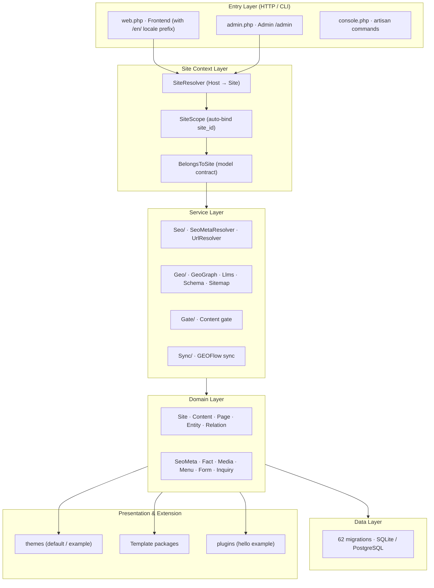

<div align="center">


# GEO Website OS

**The Open-Source Website OS for the GEO Era**

*Build business websites that are easier to maintain, easier for search engines to discover, and easier for AI systems to understand.*

[中文](./README.md) · [Docs](./docs/) · [Quick Start](#quick-start)

</div>

---

## About

GEO Website OS is an open-source enterprise website platform designed for the era of **Generative Engine Optimization (GEO)**. It brings together website content management, GEO-friendly architecture, multilingual capabilities, reusable templates, structured data, and GEOFlow content workflow collaboration.

It helps businesses build and operate websites that go beyond traditional online presence — websites designed for discoverability, machine understanding, and continuous content operations.

> **More than a website CMS. A content foundation for business websites in the AI era.**

---

## Why GEO Website OS?

Traditional business websites often face recurring challenges:

- High maintenance costs and fragmented content management.
- Website structures that are not sufficiently optimized for AI understanding.
- Expensive and difficult multilingual content operations.
- Manual content publishing and repetitive data entry.
- Repeated development work when building websites for different businesses.

GEO Website OS addresses these challenges with an integrated platform for website management, GEO-friendly content architecture, reusable templates, multilingual publishing, and content workflow collaboration.

---

## Key Features

### 1. GEO-Friendly Architecture

Make business website content easier for search engines and AI systems to interpret.

- GEO-oriented content organization and page structure
- SEO-friendly website structure
- Schema.org structured data support
- Machine-readable content organization
- `llms.txt` support
- Multilingual content structure

The goal is to make business websites not just presentable to users, but also clearly express who the business is, what products and services it offers, and what expertise it has — to both search engines and AI systems.

### 2. GEOFlow Content Workflow Integration

Connect website operations with upstream content production workflows.

- Implemented upstream content sync REST API (article / page / product)
- Import or populate website content from content production processes
- Idempotent processing: re-delivery never duplicates content
- Manual lock protection: important content is never overwritten by upstream
- Unified content gate and audit logging

> The API is implemented and covered by 108 tests in the current version. It is **disabled by default**; configure a Bearer token to activate. This moves websites from "manually maintained content" toward "continuous operations driven by content workflows."

### 3. Reusable Website Templates

Build and maintain business websites more efficiently.

- Reusable website templates (default theme + example theme)
- Declarative Template packages (activate / deactivate / migrate / validate + live preview)
- Configurable website presentation
- Reduced repetitive development and maintenance
- A foundation for industry-specific website templates

### 4. Multilingual Website Management

Manage multilingual business websites through a unified platform.

- Multilingual website content management (row-level translation model)
- Language-specific pages and content structures
- Consistent multilingual content operations
- Support for international business expansion

### 5. Unified Content Management

Make everyday website operations easier for business teams.

- Page and category management
- Content creation, editing, and publishing
- Multi-site management (host header resolution + site isolation)
- Centralized administration
- Extensible content structures

### 6. Open Source and Extensible

Maintain control over your website platform and deployment.

- Open-source codebase
- Self-hosted and private deployment
- Built with Laravel
- SQLite and PostgreSQL support
- Modular and extensible architecture

---

## GEO Website OS vs. Traditional CMS

| Dimension | Traditional CMS | GEO Website OS |
| --- | --- | --- |
| Core focus | Website content management | GEO-era business website system |
| Content management | Pages and articles publishing | Unified content management and ongoing operations |
| GEO capabilities | Often require extra configuration | GEO-friendly capabilities are part of the design |
| AI readability | Primarily human-facing | Greater emphasis on machine-readable content |
| Content production | Mostly manual editing | Can collaborate with upstream content workflows |
| Site building | Themes and custom development | Reusable templates and page structures |
| Multilingual | May require extra plugins | System-level multilingual website management |
| Extensibility | Plugins or custom development | Open source, modular, extensible |

---

## Who Is It For?

- Businesses building GEO-ready websites
- Companies seeking more efficient website content operations
- Organizations managing multilingual or multi-site websites
- Digital agencies and website solution providers
- Teams connecting AI content production with website publishing
- Organizations requiring self-hosted and extensible website platforms

---

## System Architecture



> The layering maps directly to `app/`, `routes/`, and `database/` directories. See [System Architecture](docs/architecture.md) for details.

### How GEO, SEO, and CMS Relate

```text
CMS (content & entity management: content / entities / facts / taxonomy / media / forms / inquiries / governance)
   │
   ▼
SEO (for traditional crawlers)              GEO (for generative engines / LLMs)
   ├─ canonical / hreflang / Open Graph        ├─ geo.json (entity / knowledge graph)
   ├─ sitemap.xml / robots.txt                 ├─ llms.txt (site summary & references)
   ├─ feed.xml                                 └─ AI crawler whitelist (robots.txt)
   └─ per-page JSON-LD (schema.org)
   └──────────── one source of truth (facts table) ────────────┘
```

These are not three separate modules — they are **three outputs from one data model**: CMS produces and maintains facts, SEO and GEO derive from the same source, and the AI fact contract ensures the two outputs never contradict each other.

---

## Technology Stack

| Item | Value |
| --- | --- |
| Language / Framework | PHP **8.4+** · Laravel **^12.0** |
| Dependency management | Composer 2.x |
| Database | SQLite (default, zero-config) · PostgreSQL 16 (fully supported) · MySQL 8.0+ (candidate) |
| Node.js | 20+ (**optional**, only for building frontend assets) |
| Migrations | 62, consistent across databases |
| License | MIT |

---

## Quick Start

### Requirements

- PHP 8.4+
- Composer 2.x
- SQLite (default) or PostgreSQL 16

### Installation

```bash
# Clone the repository
git clone git@github.com:jackyduhai/geo-website-os.git
cd geo-website-os

# Install dependencies
composer install

# Copy environment config
cp .env.example .env

# Generate application key
php artisan key:generate

# Create database file (SQLite default)
touch database/database.sqlite

# Run migrations
php artisan migrate --force

# Run the installer
php artisan geo:install --no-interaction
```

### Start the dev server

```bash
php artisan serve
```

Visit `http://localhost:8000` to see the frontend, or `/admin` to enter the admin panel.

---

## Documentation

| Document | Description |
| --- | --- |
| [Overview](docs/overview.md) | System positioning, core capabilities, and boundaries |
| [Architecture](docs/architecture.md) | Layering, module relationships, and core mechanisms |
| [Installation](docs/installation.md) | Requirements, configuration, and deployment |
| [Roadmap](docs/roadmap.md) | Current version capabilities and future plans |
| [Contributing](CONTRIBUTING.md) | How to contribute to the project |

---

## Our Vision

A business website in the GEO era should be more than a collection of pages.

It should be a **reliable digital information foundation** for the business —

- Accessible to people;
- Discoverable by search engines;
- Understandable to AI systems;
- Easy for teams to maintain and grow;
- Connected to content production workflows;
- Built to scale as the business evolves.

> **GEO Website OS — Build websites for the search and AI era.**

---

## License

[MIT](./LICENSE)
