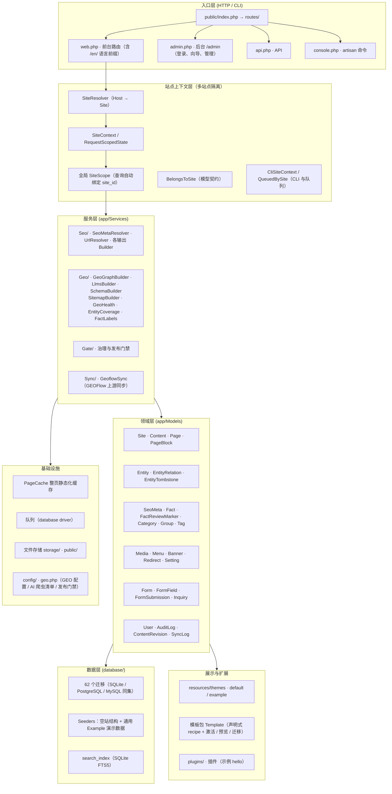

# 系统架构

> 本文描述 **v1.4.0** 的实际代码结构（`app/`、`routes/`、`database/`、`resources/`、`plugins/`）。
> 架构图使用可维护的 Mermaid 文本图，与代码目录一一对应；详细设计请按需查阅
> [`docs/architecture/`](architecture/)（历史架构决策）与 [`docs/product/`](product/)（领域设计）。

## 1. 分层总览



## 2. 模块职责（与代码目录对应）

| 目录 / 模块 | 职责 | 关键实现 |
| --- | --- | --- |
| `app/Http/Controllers` | 前台（Site/Product/…/Page dispatch）、后台（Admin/*）、GEO 输出（Feed）、API | `routes/web.php`、`routes/admin.php` |
| `app/Models` | 领域模型；统一继承 `BaseModel`（承载跨库守卫） | `BelongsToSite`、`GuardsNumericRouteBinding` |
| `app/Repositories` | 作用域安全查询 | `EntityRepository` 等 |
| `app/Services/Seo` | SEO 解析与输出 | `SeoMetaResolver`（继承链）、`UrlResolverInterface`（canonical）、Schema/Sitemap/Feed/Robots Builder |
| `app/Services/Geo` | GEO 输出与健康 | `GeoGraphBuilder`（geo.json）、`LlmsBuilder`（llms.txt）、`SchemaBuilder`（JSON-LD）、`GeoHealthService`、`EntityCoverageService`、`FactLabels` |
| `app/Services/Gate` | 发布门禁与治理 | `config/geo.php` 的 `gate`（发布强制校验） |
| `app/Services/Sync` | GEOFlow 上游内容同步 | `GeoflowSync`：幂等指纹、字段契约、人工锁、kill switch、修订快照、同步日志、事务失败有限重试 |
| `app/Support` | 支撑设施 | `SiteContext`、`SiteScope`、`PageCache`、`PublicIndex`、`PublicUrl`、`SafeUrl`、`MigrationPortability`、`CurrentDatabaseTables` 等 |
| `app/Console/Commands` | artisan 命令 | `geo:install / geo:upgrade / geo:rollback / geo:backup / geo:version / geo:backfill-seo`、`template:*`、`page-cache:*`、`search:reindex`、`media:*` |

## 3. 核心数据模型

> 下表为核心表（完整 schema 见 `database/migrations/`，三库结构一致性由 `DatabaseStructureParityTest` 锁定）。

| 领域 | 表 | 说明 |
| --- | --- | --- |
| 多站点 | `sites` | 站点行；`is_default` 唯一默认站（partial index / MySQL 生成列） |
| 内容 | `contents` | 文章/页面内容；`UNIQUE(site_id, slug, locale)`、`UNIQUE(site_id, external_id)`、`UNIQUE(site_id, slot)`（v1.4 收紧为站点级） |
| 页面 | `pages`、`page_blocks` | 结构化页面与区块；页面与实体 / 系统键的绑定约束 |
| 实体 | `entities`、`entity_relations`、`entity_tombstones` | 8 类实体（organization/person/product/service/location/topic/case_study/download_asset）与五型关系（produces/offers/uses/located_in/related_to）、墓碑删除语义 |
| 事实 | `facts`、`fact_review_markers` | **业务事实唯一权威源（SoT）**；审查标记 |
| SEO | `seo_metas` | 三态绑定（Site / Content / Entity / Page），`CHECK` + partial unique 防重 |
| 分类 | `categories`、`groups`、`tags`、`content_entity`、`content_tag` | 分类体系与内容关联（`name_en` 字段级翻译） |
| 媒体 | `media` | 媒体资产；引用守卫（被引用不可删）、删除重试 |
| 导航 | `menus`、`banners`、`redirects` | 菜单、Banner、重定向 |
| 表单/询盘 | `forms`、`form_fields`、`form_submissions`、`inquiries` | 表单与询盘（含 utm_* / landing_url / referer 归因） |
| 治理 | `users`、`audit_logs`、`content_revisions`、`sync_logs`、`settings` | 用户、审计、修订、同步日志、设置 |
| 搜索 | `search_index`（FTS5） | SQLite 全文检索虚表；MySQL / PG 走普通索引 |

## 4. 多站点机制

- **请求解析**：每个公开请求由 `Host` 头解析出**恰好一个站点**（`SiteResolver`）；查询参数**不能**切换运行站点。
- **隔离**：`SiteScope` 全局自动给 Eloquent 查询绑定 `site_id`；`BelongsToSite` 模型契约保证新模型默认带站点。数据库层（外键 + 唯一约束）与查询层双重隔离，跨站查询参数也无法绕过。
- **未知 Host**：单站/开发模式可配置回落到默认站（`SITE_DEFAULT_FALLBACK=true`）；**多站生产必须设 `false`**，未知 Host 返回「站点不存在」。
- **CLI / 队列**：CLI 用 `--site` / `--site-id` 显式选择（无效或缺失即失败）；队列任务序列化 `site_id`，运行前恢复上下文、`finally` 中清理；跨站（system）访问是显式的管理员授权能力。

## 5. 多语言机制

- 语言：`zh-CN`（默认）与 `en`，**建站时按站点启用**。
- 模型：内容、实体、事实采用**行级翻译模型**（`locale` + `translation_group`），同一 slug 可跨语言共存（`UNIQUE(site_id, slug, locale)`）。
- 路由：语言前缀路由（`/en/...`）**按站门禁**——请求未启用语言返回 404，不静默回落。
- 分类/分组：采用字段级 `name_en`（v1.0 架构选择，与行级模型并存是有意设计）。
- 已知边界：`settings` 表无 `locale` 列，同站跨语言共用 4 个设置键（P2）；Admin UI 仅中文。

## 6. SEO 与 GEO 实现机制

```mermaid
flowchart LR
    SOT["facts 表（业务事实唯一权威源）"] -->|Fact::publicRows(\$locale)| GEO1["geo.json"]
    SOT -->|Fact::publicRows(\$locale)| GEO2["llms.txt"]
    SOT -.->|"不直接读取"| SCH["SchemaBuilder (JSON-LD)"]
    META["SeoMeta（Site/Content/Entity/Page 继承链）"] --> SEO1["canonical / hreflang / Open Graph"]
    META --> SEO2["sitemap.xml"]
    META --> SEO3["feed.xml"]
    CFG["config/geo.php AI 爬虫白名单"] --> ROB["robots.txt"]
```

- **SEO 层**：`SeoMetaResolver` 按资源类型与继承链解析；`UrlResolverInterface` 生成 HTTPS canonical、去 query、统一尾斜杠、禁止跨站 canonical。
- **GEO 层**：`GeoGraphBuilder`（实体/知识图谱 → `geo.json`）、`LlmsBuilder` + `LlmsSanitizer`（→ `llms.txt`）、`SchemaBuilder`（页面 schema.org JSON-LD，与可见内容一致）、`SitemapBuilder`（→ `sitemap.xml`）、`FeedController`（feed.xml / robots.txt）。
- **AI 事实契约**：
  1. `facts` 表是业务事实的**唯一权威源**，`geo.json` 与 `llms.txt` 必须经 `Fact::publicRows($locale)` 取得；
  2. `SchemaBuilder` 不直接读 `facts`（Schema.org 字段集与业务事实表不是一一对应，实体属性类字段由站点 metadata 驱动）；
  3. 所有 AI 出口不得输出互相矛盾的事实——由 `GeoFactConsistencyTest` 强制（新增公开事实须同时登记 `FactSeeder` 与 `FactLabels`）。
- **robots.txt**：`config/geo.php` 维护各大 AI 厂商爬虫白名单（OpenAI/Anthropic/Google/Bing/Perplexity/Apple/豆包/DeepSeek/元宝/百度/阿里/Kimi/智谱/360/华为等），未列出爬虫由 `User-agent: *` 覆盖。

## 7. 缓存与性能

- **PageCache 整页静态化**：匿名请求整页缓存（匿名外壳 + 按会话回填 CSRF），`X-Page-Cache: MISS / HIT / BYPASS`；内容/栏目/媒体/设置等后台变更自动失效，无需手动清。
- 不缓存：`/admin`、`/api`、`/search`、表单提交、登录态、带非白名单查询参数的请求。
- 响应头：`Cache-Control: private, no-cache`（防表单 token 被共享缓存）；GEO 输出 `public, max-age=3600`。

## 8. 扩展点与关键设计决策

| 扩展点 | 说明 |
| --- | --- |
| 主题 Theme | `resources/themes/{default,example}`：覆盖视图不改引擎；`theme.json` 契约 |
| 模板包 Template | 声明式 recipe（区块组合），`template:activate/deactivate/migrate/validate/list/bootstrap` + 后台管理与实时预览；激活为整体事务 + 站点行锁（并发安全） |
| 插件 Plugin | `plugins/hello` 示例：ServiceProvider + 路由 + `plugin.json` |
| 内容区块 | Blocks / Sections 语义数据驱动，非自由画布（设计决策，见 roadmap「明确不做」） |
| 跨库守卫 | `BaseModel`（`GuardsNumericRouteBinding`）、`CurrentDatabaseTables`、`MigrationPortability`——跨 SQLite/PG/MySQL 的 API 差异收敛点 |

## 9. 架构一致性与证据

- 分层结构与 `app/`、`routes/`、`database/` 目录一一对应，可逐项核对。
- 三库物理差异（唯一约束形态 / 外键开关 / FTS5 / 事务锁语义 / 返回行序）见 [数据库支持矩阵](operations/database-support-and-recovery.md)，由 `DatabaseStructureParityTest` 逐项锁定。
- 历史架构决策：`docs/architecture/`、`docs/audit/18t-architecture-freeze.md`、`docs/audit/RC/D-02-Architecture-Decision-Lock.md`。
